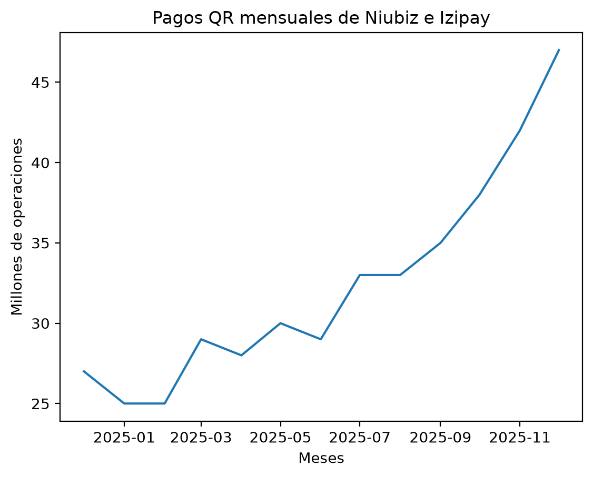

# Pagos QR en el Perú

¿Creció el monto total pagado con QR porque se hicieron más pagos o porque aumentó el monto promedio por pago? Este proyecto analiza los pagos QR procesados por Niubiz e Izipay entre diciembre de 2024 y diciembre de 2025. La base también incluye el número de transferencias en ambas direcciones entre Yape y Plin.

## Resultados

| Indicador de pagos QR | Dic. 2024 | Dic. 2025 | Variación |
| --- | ---: | ---: | ---: |
| Operaciones (millones) | 27 | 47 | +74,07 % |
| Monto total (millones de soles) | 1 031 | 1 838 | +78,27 % |
| Monto promedio por pago | S/ 38,19 | S/ 39,11 | +2,41 % |

El monto total creció principalmente porque se hicieron más pagos. De los **20 millones de operaciones adicionales**, **Niubiz aportó 11 millones (55 %)** e **Izipay, 9 millones (45 %)**.



## Datos y metodología

La base contiene **52 registros** de diciembre de 2024 a diciembre de 2025, con una fila por mes y serie. Los datos provienen de los gráficos **17** (transferencias Yape ↔ Plin), **19** (número de pagos QR) y **20** (monto pagado con QR). Los montos de las transferencias quedan vacíos porque el gráfico 17 solo presenta el número de operaciones. Los resultados son aproximados porque se calculan a partir de cifras publicadas en millones. [Reporte del BCRP de marzo de 2026](https://www.bcrp.gob.pe/docs/Publicaciones/reporte-del-sistema-nacional-de-pagos/2026/marzo/rspf-marzo-2026.pdf)

1. **Excel y Power Query.** Organicé las cifras del reporte en una tabla, convertí los meses a fechas y preparé el detalle por serie y el resumen mensual de QR.
2. **SQL Server.** Comparé las operaciones de diciembre de 2024 y diciembre de 2025 por procesador y calculé el aporte de cada uno al aumento total.
3. **Python.** Con pandas reconstruí el resumen mensual y calculé el monto promedio dividiendo el monto total entre las operaciones totales de cada mes. Con Matplotlib generé el gráfico de evolución.

## Archivos

| Archivo | Contenido |
| --- | --- |
| `detalles_pagos2.csv` | Base mensual de pagos QR y transferencias Yape ↔ Plin |
| `aporte_crecimiento_qr.sql` | Comparación de los dos diciembres y aporte por procesador |
| `crecimiento_QR.py` | Resumen mensual y generación del gráfico |
| `pagos_qr_mensuales.png` | Gráfico mensual de operaciones QR |

## Cómo reproducir el análisis

Para generar el gráfico, abre una terminal en la carpeta que contiene el CSV y el script. Ejecuta estos comandos con Python. El script guarda `pagos_qr_mensuales.png` en esa misma carpeta.

```bash
python -m pip install pandas matplotlib
python crecimiento_QR.py
```

Para reproducir la comparación en SQL Server, importa el CSV separado por punto y coma en la base `PagosQR`, como `dbo.detalles_pagos2`. Usa `date` para `Mes` y permite valores `NULL` en las columnas de monto y promedio. Comprueba que se hayan importado **52 filas** y ejecuta `aporte_crecimiento_qr.sql` en esa base.
